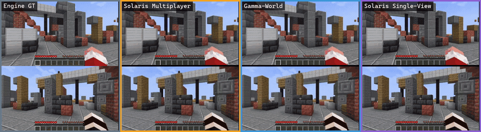
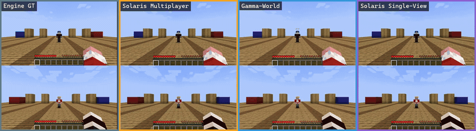
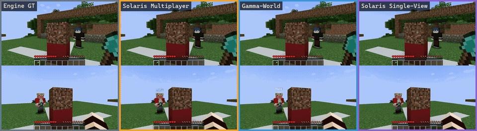
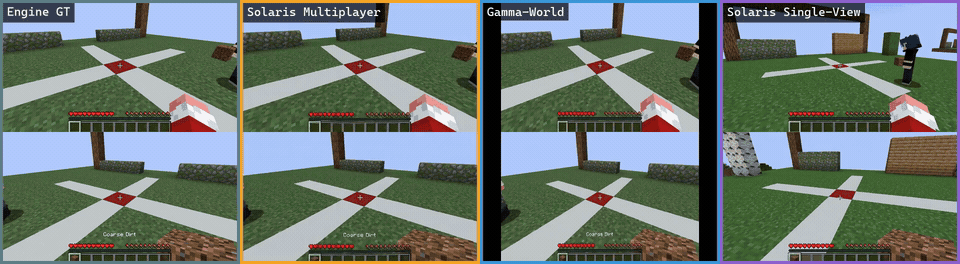
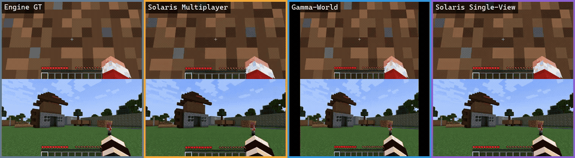
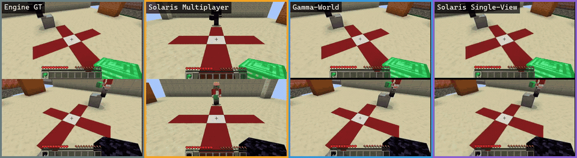
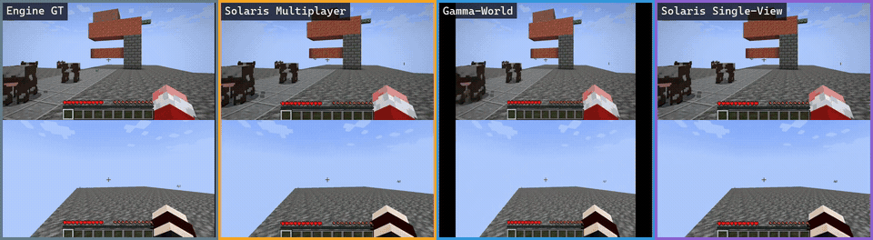
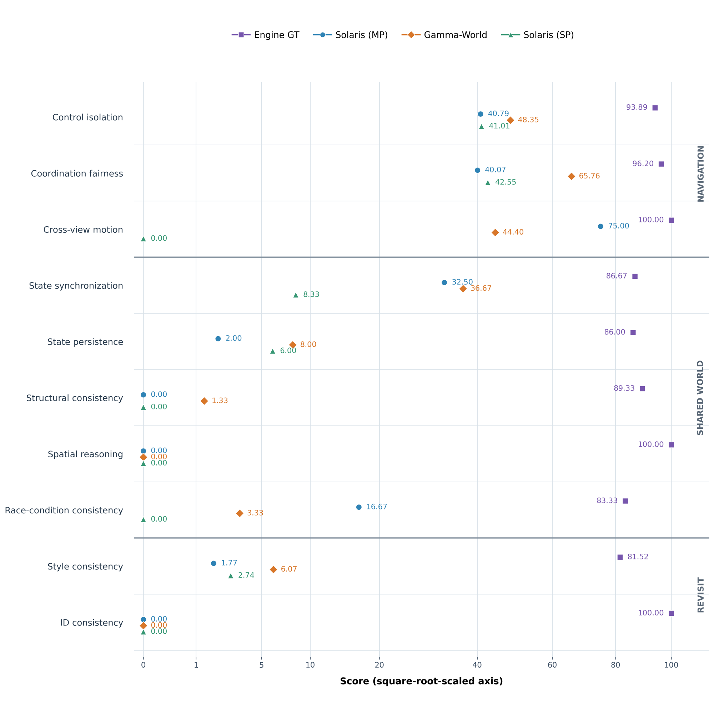
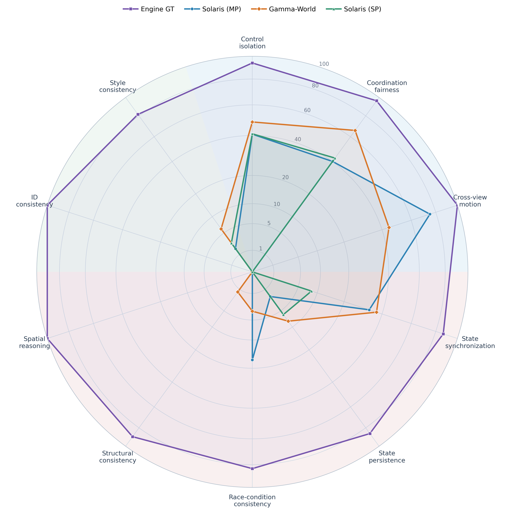

<h1 align="center">MultiWorldBench</h1>

<h3 align="center">Do Independently Controlled Views Describe One Shared World?</h3>

<p align="center">
  <a href="https://arxiv.org/abs/2610.11723"></a>
</p>

<p align="center"><strong>A diagnostic benchmark for testing whether independently controlled Minecraft views remain grounded in one shared and persistent world.</strong></p>

<p align="center">Navigation · Shared-world interaction · Concurrent action · Delayed revisit</p>

> [!NOTE]
> This repository releases the V4 evaluation protocol, task configurations, prompts, portable scoring entry points, and regression tests. Recorded or generated videos, model weights, training code, and server-specific capture or inference orchestration are not included.

## ✨ Highlights

<table align="center">
  <tr>
    <td width="25%" align="center">🧪<br><strong>495</strong><br><sub>case configurations</sub></td>
    <td width="25%" align="center">🗂️<br><strong>7</strong><br><sub>task suites</sub></td>
    <td width="25%" align="center">🎯<br><strong>10</strong><br><sub>capabilities</sub></td>
    <td width="25%" align="center">🧭<br><strong>3</strong><br><sub>evaluation tracks</sub></td>
  </tr>
</table>

<table>
  <tr>
    <td width="33%" valign="top" align="center"><h3>🧭 Navigation</h3><p>Independent control, coordination fairness, and cross-view motion.</p></td>
    <td width="34%" valign="top" align="center"><h3>🌐 Shared World</h3><p>Synchronization, persistence, structure, space, and concurrent interaction.</p></td>
    <td width="33%" valign="top" align="center"><h3>⏱️ Revisit</h3><p>Style and building identity after a delayed cross-player return.</p></td>
  </tr>
</table>

<p align="center"><code>Independent controls</code> → <code>Paired observations</code> → <code>Shared-world diagnostics</code></p>

## 🧩 Benchmark Coverage & Qualitative Examples

### Coverage Map

| Track | Task suite | Cases | Evaluated capabilities |
| --- | --- | ---: | --- |
| Navigation | Matched navigation | 180 | Control isolation; coordination fairness |
| Navigation | Cross-view motion | 20 | Cross-view motion consistency |
| Shared world | Shared-state interaction | 120 | State synchronization |
| Shared world | Shared-state persistence | 50 | State persistence |
| Shared world | Building reveal | 75 | Structural consistency; spatial reasoning |
| Shared world | Concurrent placement | 30 | Race-condition consistency |
| Revisit | Delayed cross-player revisit | 20 | Style consistency; building-identity consistency |
| **Total** | **Seven task suites** | **495** | **Ten capabilities** |

Single-agent control consistency is additionally used as an eligibility diagnostic for navigation isolation.

### Qualitative Gallery

The examples below compare paired views across **Engine GT**, **Solaris Multiplayer**, **Gamma-World**, and **Solaris Single-View**. Every animation plays automatically and loops; use the MP4 link below each example for full-resolution playback.

<h3 align="center">🧭 Navigation</h3>

<h4 align="center"><code>01</code> · Control Isolation</h4>

<p align="center">
  
</p>

<h4 align="center"><code>02</code> · Cross-view Motion</h4>

<p align="center">
  
</p>

<br>

<h3 align="center">🌐 Shared-World Consistency</h3>

<h4 align="center"><code>03</code> · State Synchronization</h4>

<p align="center">
  
</p>

<h4 align="center"><code>04</code> · State Persistence</h4>

<p align="center">
  
</p>

<h4 align="center"><code>05</code> · Structural Consistency &amp; Spatial Reasoning</h4>

<p align="center">
  
</p>

<h4 align="center"><code>06</code> · Race-Condition Consistency</h4>

<p align="center">
  
</p>

<br>

<h3 align="center">⏱️ Delayed Revisit</h3>

<h4 align="center"><code>07</code> · Style &amp; Building-Identity Consistency</h4>

<p align="center">
  
</p>

## 📊 Core Results

Scores are reported on a 0–100 scale; higher is better. Track averages weight their constituent capabilities equally, and the overall average weights all ten capabilities equally.

| Track | Capability | Cases | Engine GT | Solaris (MP) | Gamma-World | Solaris (SP) |
| --- | --- | ---: | ---: | ---: | ---: | ---: |
| Navigation | Control isolation | 180 | 93.89 | 40.79 | **48.35** | 41.01 |
| Navigation | Coordination fairness | 180 | 96.20 | 40.07 | **65.76** | 42.55 |
| Navigation | Cross-view motion | 20 | 100.00 | **75.00** | 44.40 | 0.00 |
| Navigation | **Track average** | — | **96.70** | **51.95** | **52.84** | **27.85** |
| Shared world | State synchronization | 120 | 86.67 | 32.50 | **36.67** | 8.33 |
| Shared world | State persistence | 50 | 86.00 | 2.00 | **8.00** | 6.00 |
| Shared world | Structural consistency | 75 | 89.33 | 0.00 | **1.33** | 0.00 |
| Shared world | Spatial reasoning | 75 | 100.00 | **0.00** | **0.00** | **0.00** |
| Shared world | Race-condition consistency | 30 | 83.33 | **16.67** | 3.33 | 0.00 |
| Shared world | **Track average** | — | **89.07** | **10.23** | **9.87** | **2.87** |
| Revisit | Style consistency | 20 | 81.52 | 1.77 | **6.07** | 2.74 |
| Revisit | ID consistency | 20 | 100.00 | **0.00** | **0.00** | **0.00** |
| Revisit | **Track average** | — | **90.76** | **0.89** | **3.04** | **1.37** |
| **Overall** | **Overall average** | — | **91.69** | **20.88** | **21.39** | **10.06** |

<table>
  <tr>
    <td width="50%" align="center"></td>
    <td width="50%" align="center"></td>
  </tr>
  <tr>
    <td align="center"><strong>Ten-capability score profile</strong></td>
    <td align="center"><strong>Ten-capability radar profile</strong></td>
  </tr>
</table>

## 🧰 Released Evaluation Code

The current evaluation release lives in [`benchmark_v4`](benchmark_v4/README.md). Older controller code remains available for compatibility; its previous README is archived in [`docs/legacy-v3.md`](docs/legacy-v3.md).

The release contains:

- configurations for all seven task suites;
- portable navigation, shared-world, and revisit scoring entry points;
- input and evidence schemas;
- prompts and output validators;
- metric definitions and validity gates; and
- regression tests for the released protocol.

## 🚀 Quick Start

Python 3.10 or later is recommended.

```bash
git clone https://github.com/clipspark/multiworldbench.git
cd multiworldbench/benchmark_v4
python -m venv .venv
source .venv/bin/activate
pip install -r requirements.txt
```

On Windows PowerShell, activate the environment with:

```powershell
.\.venv\Scripts\Activate.ps1
```

Inspect the available evaluation entry points:

```bash
python score_navigation.py --help
python score_shared_world.py --help
python score_revisit.py --help
```

For VLM inference and development checks, install the corresponding optional requirements:

```bash
pip install -r requirements-vlm.txt
pip install -r requirements-dev.txt
python -m pytest -q
```

Before preparing evidence, read the [evaluation guide](benchmark_v4/README.md), [input contracts](benchmark_v4/docs/inputs.md), and [metric definitions](benchmark_v4/docs/metrics.md).

## 🧪 Usage Examples

Run these commands from `benchmark_v4`.

### Navigation evaluation

```bash
python estimate_poses.py --run /path/to/run --model gt \
  --case CASE_ID --role alpha --mcv-root /path/to/MCV \
  --replenish --robust-tracking --backward-recovery \
  --output-root /path/to/poses

python score_navigation.py --run /path/to/run \
  --estimates-root /path/to/poses \
  --output-dir /path/to/scores \
  --models gt solaris gamma mineworld
```

### Shared-world evaluation

```bash
python judge_jobs.py --suite synchronization \
  --cases configs/shared_world/synchronization120.json \
  --jobs /path/to/jobs.json \
  --checkpoint /path/to/Qwen2.5-VL \
  --device cuda:0 \
  --output-dir /path/to/judgments

python score_shared_world.py --suite synchronization \
  --evidence /path/to/judgments/evidence.json \
  --output /path/to/synchronization_scores.json
```

### Revisit evaluation

```bash
python judge_jobs.py --suite revisit \
  --cases configs/revisit/handoff20.json \
  --jobs /path/to/revisit_jobs.json \
  --checkpoint /path/to/Qwen2.5-VL \
  --device cuda:0 \
  --output-dir /path/to/id_judgments

python score_revisit.py \
  --evidence /path/to/revisit_evidence.json \
  --output /path/to/revisit_scores.json
```

Missing generation or evidence is treated as unavailable rather than silently converted into a zero. Report eligibility and coverage alongside scores.

## 🔍 Implementation Notes

Navigation uses map-anchored MCV camera poses with point replenishment, robust tracking, and optional backward recovery. V4 cross-view motion uses direct VLM judgments; both the observer and actor judgments must be correct for a case to pass.

The deployed building-geometry helper uses **SAM2.1 Hiera Large plus image registration**, including a registration-derived camera-angle proxy. It does **not** implement the manuscript's SAM3/PnP geometry description. This implementation difference is documented in the [evaluation guide](benchmark_v4/README.md) and [metric definitions](benchmark_v4/docs/metrics.md).

## 🏢 Release

MultiWorldBench is released by **Zhiying Guangnian Technology Co., Ltd.**

## 🏷️ Version Information

| Component | Version / date | Notes |
| --- | --- | --- |
| Paper | arXiv v4, 20 October 2026 | Current manuscript linked in this README |
| Evaluation protocol | V4 | Navigation V4 plus the latest shared-world and revisit evaluators |
| Code export | 8 October 2026 | Portable evaluation release under `benchmark_v4` |
| Legacy code | V3 | Retained for compatibility and provenance |

The repository currently provides a protocol/code snapshot rather than a tagged GitHub Release. When publishing a formal release, add the release tag and changelog here.

## 📚 Citation

If you find MultiWorldBench useful, please cite:

```bibtex
@article{xu2026multiworldbench,
  title   = {MultiWorldBench: Do Independently Controlled Views Describe One Shared World?},
  author  = {Xu, Zhangbo and Zhang, Ruoxi and Hu, Rui and Wang, Yisong and Li, Xitong and Wang, Jingdong},
  journal = {arXiv preprint arXiv:2610.11723},
  year    = {2026},
  doi     = {10.48550/arXiv.2610.11723}
}
```

## 🙏 Acknowledgments and License

The release uses external [MCV](https://github.com/rubyswolf/MCV), [SAM2](https://github.com/facebookresearch/sam2), [Qwen2.5-VL](https://github.com/QwenLM/Qwen2.5-VL), and [Cosmos-Reason1](https://github.com/nvidia-cosmos/cosmos-reason1) components. The repository organization takes inspiration from [WBench](https://github.com/meituan-longcat/WBench).

The exported evaluation code carries the source Apache-2.0 license in [`benchmark_v4/LICENSE`](benchmark_v4/LICENSE). External dependencies and checkpoints retain their own licenses.
